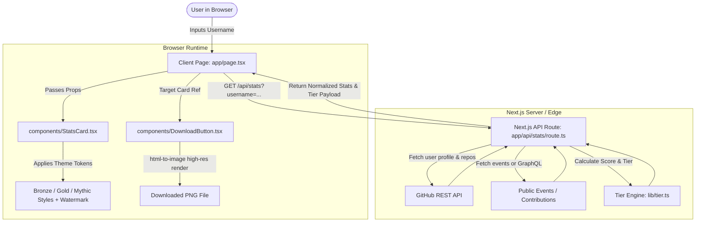

# Implementation Action Plan: GitHub Stats & Performance Tier Card

This plan outlines the architecture and phased implementation for building the GitHub Stats Card generator with Next.js App Router, TypeScript, and Tailwind CSS.

---

## Architecture Diagram

---

## Phased Execution Roadmap

### Phase 1: Project Setup & Type Definitions
- **Deliverables**:
  - `types/stats.ts`: Interfaces for GitHub user profile, repository stars aggregator, tier definitions (`Bronze`, `Gold`, `Mythic`), and API response payload.
  - `lib/tier.ts`: Pure scoring function and metadata lookup mapping scores to tier themes, badges, and descriptions.

### Phase 2: API Route Implementation (`app/api/stats/route.ts`)
- **Key Operations**:
  - Sanitize and validate `username` query parameter.
  - Query `https://api.github.com/users/{username}` for core profile and follower count.
  - Query user repositories (`/users/{username}/repos?per_page=100&sort=pushed`) to sum stargazers across public repositories.
  - Query public events (`/users/{username}/events/public?per_page=100`) to estimate active 90-day contributions (or GraphQL fallback if `GITHUB_TOKEN` is supplied).
  - Compute performance tier score using `calculateTier(stats)`.
  - Return standardized JSON response with cache headers (`Cache-Control: s-maxage=3600, stale-while-revalidate=1800`) and comprehensive error handling (400, 404, 403, 500).

### Phase 3: Styled Tier Card Component (`components/StatsCard.tsx`)
- **Visual Design Specifications**:
  - **Bronze Tier**:
    - Background: `bg-gradient-to-br from-zinc-800 via-neutral-900 to-stone-950`
    - Border: `border border-zinc-700/60 shadow-lg shadow-zinc-950/40`
    - Accent: Brushed bronze/zinc badges, subtle metallic highlights.
  - **Gold Tier**:
    - Background: `bg-gradient-to-br from-amber-950/40 via-yellow-950/20 to-neutral-950`
    - Border: `border border-amber-500/40 shadow-xl shadow-amber-500/10`
    - Accent: Radiant gold text gradients, amber badge glows, warm highlights.
  - **Mythic Tier**:
    - Background: `bg-gradient-to-br from-indigo-950/60 via-purple-950/40 to-black`
    - Border: `border border-indigo-500/50 shadow-2xl shadow-indigo-500/20`
    - Accent: Holographic iridescent gradients (cyan-to-magenta), cybernetic badge styling, luminous glowing borders.
  - **Watermark**:
    - Minimalist badge in bottom right corner: `gitstats.app • verified tier`.
    - Styled with high typographic finesse (mono font, subtle opacity `text-zinc-500/70`).

### Phase 4: Download Engine (`components/DownloadButton.tsx`)
- **Integration**:
  - Leverages `html-to-image` via `toPng(domNode, options)`.
  - Uses `pixelRatio: 2` (or `3`) for 300DPI crisp rendering.
  - Embeds CORS-compatible image handling to prevent tainted canvas bugs with GitHub avatars.
  - Provides a clean loading spinner and disabled state during capture.

### Phase 5: Interactive Preview Page (`app/page.tsx`)
- Search input bar to test any GitHub handle (with instant sample profiles like `torvalds`, `shadcn`, `gaearon`).
- Live tier preview switching, error banners, and card download action.

---

## Immediate Next Step
Execute the foundation code files:
1. `types/stats.ts`
2. `lib/tier.ts`
3. `app/api/stats/route.ts`
4. `components/StatsCard.tsx`
5. `components/DownloadButton.tsx`
