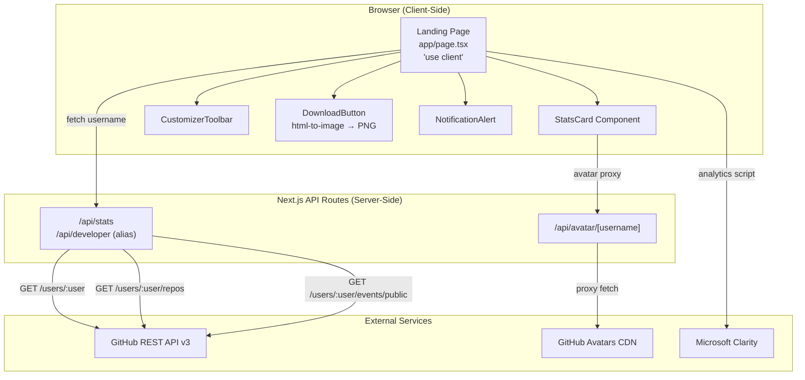
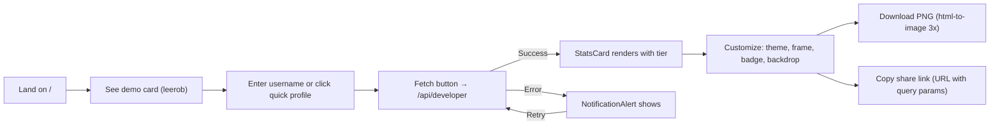
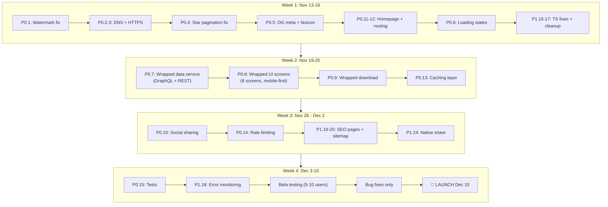

# Phase 0 — Repository Audit & Scope Lock

**Project:** GitStats → `mygitstats.dev`
**Audited:** November 13, 2026
**Target Launch:** December 10, 2026
**Current Deployment:** https://github-stats-s3gs.onrender.com

---

## 1. Current Architecture



### Tech Stack

| Layer | Technology | Version |
|---|---|---|
| Framework | Next.js (App Router) | 14.2.18 |
| Language | TypeScript | 5.6.3 |
| Runtime | Node.js | 22 (Alpine) |
| UI | React | 18.3.1 |
| Styling | Tailwind CSS | 3.4.15 |
| Image Export | html-to-image | 1.11.11 |
| Icons | lucide-react | 0.460.0 |
| CSS Utilities | clsx + tailwind-merge | — |
| Deployment | Render (Docker, free plan) | — |
| Analytics | Microsoft Clarity | — |
| CI/CD | GitHub Actions (release + snapshot) | — |

### Key Architecture Facts

- **Single-page app** — entire product lives in `app/page.tsx` as a `"use client"` component
- **No database** — fully stateless, no persistence layer
- **No authentication** — no OAuth, no user accounts
- **No routing** — only `/` exists as a page; no `/wrapped`, no `/about`, no SEO landing pages
- **Standalone Docker output** — configured via `next.config.mjs` with `output: "standalone"`
- **TypeScript errors ignored** during build (`ignoreBuildErrors: true`)
- **ESLint ignored** during build (`ignoreDuringBuilds: true`)

---

## 2. File Inventory

### Source Files (17 files)

| Path | Purpose | Lines |
|---|---|---|
| `app/layout.tsx` | Root layout, metadata, Clarity script | 44 |
| `app/page.tsx` | **Entire application UI** | 447 |
| `app/globals.css` | Base CSS variables | 15 |
| `app/api/stats/route.ts` | GitHub API aggregation | 249 |
| `app/api/developer/route.ts` | Re-export of /api/stats | 1 |
| `app/api/avatar/route.ts` | Avatar proxy (base) | 64 |
| `app/api/avatar/[username]/route.ts` | Avatar proxy (per-user cache busting) | 67 |
| `components/StatsCard.tsx` | Card rendering component | 404 |
| `components/DownloadButton.tsx` | PNG export via html-to-image | 132 |
| `components/NotificationAlert.tsx` | Error/notification display | 238 |
| `components/builder/CustomizerToolbar.tsx` | Theme/frame/badge/backdrop selector | 295 |
| `lib/tier.ts` | Scoring algorithm & tier classification | 87 |
| `lib/utils.ts` | `cn()` utility | 6 |
| `lib/themes/cityThemes.ts` | 8 city theme configurations | 219 |
| `lib/themes/frameStyles.tsx` | Frame, badge, background configs | 139 |
| `types/stats.ts` | API & data type definitions | 94 |
| `types/builder.ts` | Customizer type definitions | 63 |

### Configuration & Infrastructure

| File | Purpose |
|---|---|
| `package.json` | Dependencies (7 prod, 7 dev) — very lean |
| `next.config.mjs` | Next.js config with standalone output |
| `tailwind.config.ts` | Custom shadows, animations |
| `Dockerfile` | Multi-stage Alpine build |
| `render.yaml` | Render IaC blueprint |
| `.env.example` | Single env var: `GITHUB_TOKEN` |
| `.github/workflows/release.yml` | CI: lint → build → release → Render deploy |

### No Tests Exist

Zero project test files. No test runner installed (no Jest, Vitest, Playwright, or Cypress in dependencies).

---

## 3. API & Route Inventory

### Pages
| Route | Handler | SSR? | Notes |
|---|---|---|---|
| `/` | `app/page.tsx` | CSR only (`"use client"`) | Entire app — no server rendering |

### API Routes
| Route | Method | Purpose | Auth | Caching |
|---|---|---|---|---|
| `/api/stats?username=X` | GET | Fetch user profile, repos, events → compute tier | Optional `GITHUB_TOKEN` server-side | `s-maxage=3600, stale-while-revalidate=1800` |
| `/api/developer?username=X` | GET | Alias for `/api/stats` (avoids ad-blocker) | Same | Same |
| `/api/avatar?url=X` | GET | CORS proxy for GitHub avatars | None | `max-age=86400` |
| `/api/avatar/[username]?url=X` | GET | Per-user avatar proxy (cache-bust) | None | `max-age=86400` |

### GitHub API Calls (per user fetch)
| Endpoint | Data Retrieved | Rate Impact |
|---|---|---|
| `GET /users/{username}` | Profile, followers, public_repos | 1 request |
| `GET /users/{username}/repos?per_page=100&sort=pushed&type=owner` | First 100 repos (for star count) | 1 request |
| `GET /users/{username}/events/public?per_page=100` | Last ~90 days of public events | 1 request |
| **Total per user lookup** | — | **3 requests** |

> **⚠️ Star count is incomplete:** Only first 100 repos are fetched. Users with 100+ repos will have understated star totals. Pagination is not implemented.

---

## 4. Current User Journey



### UX Gaps Identified

| # | Gap | Severity |
|---|---|---|
| 1 | **No loading skeleton** — UI jumps from old data to new data with only a spinner on the button | Medium |
| 2 | **Demo data shows on first load** — user sees leerob's stats before doing anything, which is confusing ("is this my data?") | Medium |
| 3 | **Watermark hardcoded** to `github-stats-s3gs.onrender.com` in `StatsCard.tsx` line 397 — must update to `mygitstats.dev` | **High** |
| 4 | **No page title update** after fetching a user — tab always says "GitHub Stats Card & Performance Tier Generator" | Low |
| 5 | **URL params sync is one-way** — params are read on mount but not written back to URL bar after fetch (only share link copies them) | Low |
| 6 | **No empty state** — if the API returns 0 stars, 0 followers, the card still renders but looks hollow | Low |
| 7 | **Share = clipboard only** — no social share buttons (X, LinkedIn), no share sheet | Medium |
| 8 | **No favicon** — `public/favicon.svg` exists but no metadata references it (no `<link rel="icon">` in layout) | Low |
| 9 | **No OG metadata** — no `og:image`, `og:url`, Twitter cards | **High** |
| 10 | **No SEO content** — single CSR page, no indexable content | High |
| 11 | **Incomplete star count** for prolific users (100 repo limit) | Medium |
| 12 | **No mobile-specific testing evidence** — responsive classes exist but no breakpoint verification | Medium |

---

## 5. Feature Inventory

### ✅ Keep — Working & Valuable

| Feature | Location | Notes |
|---|---|---|
| GitHub username lookup | `app/page.tsx` L123-268 | Solid error handling with typed errors |
| Input sanitization | Same | Strips `@`, extracts from github.com URLs |
| Performance tier system | `lib/tier.ts` | 3 tiers: Bronze / Gold / Mythic |
| 8 city themes | `lib/themes/cityThemes.ts` | Tokyo, Berlin, Bangalore, Hyderabad, SF, Paris, Frankfurt, Shanghai |
| 5 avatar frames | `lib/themes/frameStyles.tsx` | Squircle, Circle, Cyber Hex, Neon Ring, Brushed Metal |
| 5 badge styles | Same file | Tier, Verified, Fire, Royal, Dot |
| 5 card backgrounds | Same file | Ambient, Cyber Grid, Glassmorphic, Mesh, Pure Matte |
| High-res PNG export | `components/DownloadButton.tsx` | 3x retina, Brave-compatible |
| Avatar proxy | `/api/avatar/[username]` | Solves CORS/tainted canvas for export |
| Error notification system | `components/NotificationAlert.tsx` | 6 error types with specific UI |
| Share link (clipboard) | `app/page.tsx` L280-296 | Encodes user + theme + frame + badge + bg in URL |
| Quick profiles | `app/page.tsx` L343-358 | shadcn, torvalds, etc. — great for first-visit |
| URL param restoration | `app/page.tsx` L88-110 | Share links restore state |
| GitHub API rate-limit handling | `app/api/stats/route.ts` L113-128 | Shows reset time |
| Ad-blocker bypass | `/api/developer` alias | Prevents Brave Shields from blocking `/api/stats` |
| CI/CD pipeline | `.github/workflows/release.yml` | Lint → Build → Release → Render deploy |

### 🔧 Fix — Valuable but Broken/Incomplete

| Feature | Issue | Impact |
|---|---|---|
| Star count | Only first 100 repos — no pagination | Users with 100+ repos get wrong tier |
| Watermark URL | Hardcoded to Render URL, not `mygitstats.dev` | Brand damage on exported cards |
| TypeScript/ESLint | Both ignored during build — hiding real errors | Unknown technical debt |
| `frameStyles.ts` vs `frameStyles.tsx` | Both exist in `lib/themes/` — `.ts` is likely dead code | Confusing |

### ✨ Improve — Working but Needs Polish

| Feature | What to Improve |
|---|---|
| Landing page | Add clear value proposition, hero section, CTA |
| Loading state | Add skeleton/shimmer during fetch |
| Share functionality | Add social buttons (X, LinkedIn), native share API |
| Metadata | Add OG image, Twitter cards, favicon link |
| Demo data | Consider showing empty state or hero instead of pre-filled leerob data |
| Customizer UX | Labels could be clearer on mobile |

### ⏳ Defer — Not for December Launch

| Feature | Reason |
|---|---|
| SVG export | Complex to render correctly, PNG is working well |
| User accounts | No persistence layer, adds complexity |
| OAuth/authorized data | Public API is sufficient for MVP |
| Video/animation export | High complexity, low launch value |
| Markdown embed endpoint (live SVG) | Needs server-side rendering infra |

### 🗑️ Remove — Not Needed

| Item | Reason |
|---|---|
| `lib/themes/frameStyles.ts` | Likely dead duplicate of `.tsx` version — verify and remove |
| `app/api/avatar/route.ts` (base) | Superseded by `[username]/route.ts` — verify usage |

---

## 6. Environment Variable Inventory

| Variable | Required | Where Used | Purpose |
|---|---|---|---|
| `GITHUB_TOKEN` | Optional (strongly recommended) | `/api/stats` server-side | Elevates rate limit from 60 → 5,000 req/hr |
| `NODE_ENV` | Auto | Build/runtime | production/development |
| `PORT` | Auto (3000) | Dockerfile/Render | Server port |
| `HOSTNAME` | Auto (0.0.0.0) | Dockerfile/Render | Bind address |
| `RENDER_DEPLOY_HOOK` | Optional | GitHub Actions | Auto-deploy trigger |

> Only 1 meaningful env var (`GITHUB_TOKEN`). This is excellent — minimal config surface. For the Wrapped feature, we'll need to decide if this PAT is sufficient or if we need GraphQL-specific scoping.

---

## 7. Risk Register

| # | Risk | Likelihood | Impact | Mitigation |
|---|---|---|---|---|
| **R1** | GitHub API rate limits during viral launch (60 req/hr unauthenticated, 5,000/hr with PAT) | High | **Critical** | Configure `GITHUB_TOKEN` PAT. Add aggressive server-side caching. Add client-side rate-limit messaging. |
| **R2** | `html-to-image` inconsistencies across browsers/mobile | Medium | High | Test on Safari, Chrome, Firefox, Brave mobile. Add fallback messaging. |
| **R3** | Render free plan cold starts (30+ seconds) | High | High | Evaluate migration to Vercel or Cloudflare Pages for frontend. Keep Render for backend if needed. |
| **R4** | Star count wrong for users with 100+ repos | High | Medium | Implement pagination (up to 3-5 pages) or document limitation. |
| **R5** | GitHub Wrapped data limitations (Events API = ~90 days only) | Certain | High | Use GraphQL `contributionsCollection` for year-long data. Requires server-side PAT. |
| **R6** | No tests — regressions go undetected | High | High | Add basic API route tests and component smoke tests. |
| **R7** | Ignored TypeScript errors hiding bugs | Medium | Medium | Run `tsc --noEmit` to surface issues, fix critical ones. |
| **R8** | Single-page CSR = no SEO indexability | Certain | Medium | Add server-rendered landing pages for key routes. |
| **R9** | No error monitoring beyond Clarity | High | Medium | Add Sentry or similar (free tier). |
| **R10** | Domain migration breaks existing share links | Low | Low | Old Render URL should redirect. Share links use relative paths. |

---

## 8. GitHub API Data Assessment for Wrapped

This is the **most critical technical decision** for the Wrapped feature.

### What Public REST API Gives Us

| Data Point | Endpoint | Coverage | Limitation |
|---|---|---|---|
| Profile info | `/users/{user}` | Full | — |
| Followers, public repos | `/users/{user}` | Full | — |
| Repository list | `/users/{user}/repos` | First 100 | Pagination needed |
| Stars per repo | Repo list | Per-page only | Same |
| Languages per repo | `/repos/{owner}/{repo}/languages` | Full | 1 API call per repo — expensive |
| Recent public events | `/users/{user}/events/public` | **Last ~90 days max** | ❌ Cannot get full year |
| Contribution calendar | ❌ Not available in REST | — | — |
| Total commits in a year | ❌ Not available in REST | — | — |
| PR count across all repos | ❌ Not available in REST | — | — |

### What GraphQL API Gives Us (with server-side PAT)

| Data Point | Query | Coverage |
|---|---|---|
| `contributionsCollection(from, to)` | Full year contributions | ✅ Commits, PRs, issues, reviews, repos contributed to |
| `totalCommitContributions` | Exact annual commit count | ✅ |
| `totalPullRequestContributions` | Annual PR count | ✅ |
| `totalIssueContributions` | Annual issue count | ✅ |
| `totalRepositoryContributions` | New repos created | ✅ |
| `contributionCalendar.weeks` | The green squares heatmap | ✅ |
| `popularContribution` | Most-starred repo | ✅ |
| `repositoriesContributedTo` | External contributions | ✅ |

> **Decision needed:** The GraphQL API with a server-side PAT is essential for a meaningful Wrapped experience. The REST Events API cannot provide year-long data. This PAT needs no special OAuth scopes — public profile read access works.

### Recommended Wrapped Data Model (MVP)

```typescript
interface WrappedData {
  user: UserProfile;
  year: number;

  // From GraphQL contributionsCollection
  totalCommits: number;
  totalPRs: number;
  totalIssues: number;
  totalReviews: number;
  totalReposContributed: number;
  newReposCreated: number;
  contributionCalendar: Week[];  // for heatmap

  // From REST repos endpoint (paginated)
  topLanguages: { name: string; bytes: number }[];
  topRepos: { name: string; stars: number; language: string }[];
  totalStars: number;

  // Computed
  busiestDay: { date: string; count: number };
  longestStreak: number;
  developerPersonality: string;  // fun label based on patterns

  // Metadata
  dataSource: "public";  // always honest
  fetchedAt: string;
  coverage: string;  // "Based on public GitHub activity"
}
```

---

## 9. Prioritized Backlog

### P0 — Launch Blockers

| # | Task | Phase | Est. Effort |
|---|---|---|---|
| 1 | Update watermark URL to `mygitstats.dev` | 1 | 10 min |
| 2 | Configure `mygitstats.dev` DNS → hosting | 1 | 1-2 hrs |
| 3 | Add HTTPS + canonical URL | 1 | 30 min |
| 4 | Fix star count pagination (at least 3 pages = 300 repos) | 2 | 1 hr |
| 5 | Add OG metadata + favicon link to layout | 2 | 1 hr |
| 6 | Add loading skeleton/shimmer during fetch | 2 | 2 hrs |
| 7 | Build Wrapped data service (GraphQL + REST) | 3 | 6-8 hrs |
| 8 | Build 6-screen Wrapped UI | 3 | 10-14 hrs |
| 9 | Build Wrapped summary download | 3 | 3-4 hrs |
| 10 | Add social share buttons (X, LinkedIn) | 4 | 2-3 hrs |
| 11 | Create homepage with value prop + nav | 2 | 4-6 hrs |
| 12 | Add `/wrapped` and `/card` routes | 2/3 | 2-3 hrs |
| 13 | Server-side caching for Wrapped aggregation | 3 | 3-4 hrs |
| 14 | Rate limiting on API endpoints | 6 → 1 | 2-3 hrs |
| 15 | Basic API route tests | 6 | 3-4 hrs |

### P1 — Important but Not Blocking

| # | Task | Phase | Est. Effort |
|---|---|---|---|
| 16 | Fix TypeScript errors (run `tsc --noEmit`) | 0 | 1-2 hrs |
| 17 | Clean up dead `frameStyles.ts` file | 0 | 10 min |
| 18 | Add Sentry or error monitoring | 6 | 1 hr |
| 19 | SEO landing page content | 5 | 3-4 hrs |
| 20 | XML sitemap + robots.txt | 5 | 1 hr |
| 21 | Render → Vercel migration (if cold starts are bad) | 1 | 2-4 hrs |
| 22 | Mobile layout verification + fixes | 2 | 2-3 hrs |
| 23 | README embed/copy snippet | 2 | 2-3 hrs |
| 24 | Native share API integration | 4 | 1 hr |

### P2 — Nice to Have

| # | Task | Phase |
|---|---|---|
| 25 | More tier levels (Silver, Diamond, etc.) | Post-launch |
| 26 | Animated card transitions | Post-launch |
| 27 | OAuth for private contribution data | Post-launch |
| 28 | User accounts / saved cards | Post-launch |
| 29 | Blog/content pages | Post-launch |

---

## 10. Proposed Implementation Sequence



---

## 11. Smallest Viable Launch Scope

If time runs out, this is the absolute minimum for a credible December 10 launch:

1. ✅ `mygitstats.dev` resolving with HTTPS
2. ✅ Stats Card generator working end-to-end (current + fixes)
3. ✅ Wrapped: single summary card (not full 6 slides) with key annual stats
4. ✅ PNG download for both card and wrapped
5. ✅ Share link + at least copy-to-clipboard
6. ✅ Basic homepage with clear CTA
7. ✅ OG metadata for social previews
8. ✅ `GITHUB_TOKEN` configured for rate limits

**What gets cut in this scenario:**
- Full 6-screen slide experience → single-page wrapped summary
- SEO landing pages → just homepage
- Animated transitions → static
- README embed → deferred
- Error monitoring → rely on Clarity

---

## 12. Top Launch Blockers (Immediate)

| # | Blocker | Action Required |
|---|---|---|
| **1** | Hardcoded Render URL in watermark | Change string in StatsCard.tsx |
| **2** | No GraphQL integration for Wrapped data | Build new data service |
| **3** | No routes beyond `/` | Add app router pages |
| **4** | No OG metadata | Add to layout + per-page |
| **5** | Star count incorrect for prolific users | Add pagination |

---

## 13. Honest Assessment

**What's genuinely good about this codebase:**
- Clean, well-organized code with consistent patterns
- Strong error handling with typed error states
- Thoughtful browser compatibility (Brave proxy, ad-blocker bypass, opaque backgrounds)
- Beautiful visual design system with 8 city themes
- Lean dependency tree (only 7 prod deps)
- Working CI/CD pipeline

**What needs work:**
- Zero tests
- Single CSR page (no SEO surface)
- No server-side rendering capability for share/OG pages
- No persistence for caching or share pages
- GraphQL integration needed from scratch for Wrapped

**Estimated total effort to launch:** ~60-80 hours of focused development work across 28 days. Achievable for a dedicated solo developer with LLM assistance, but requires discipline.

---

> **Audit complete. Recommended start: Watermark fix + DNS configuration + star pagination.**
